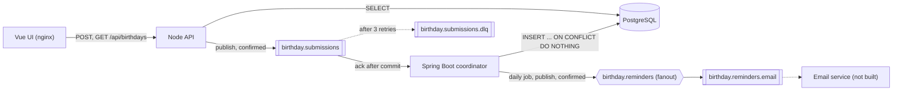

# Birthday Tracker

A small system for tracking birthdays and sending reminders before each one. A Vue UI submits birthdays to a Node API, which validates them and publishes them to RabbitMQ. A Spring Boot coordinator saves them to PostgreSQL and, once a day, publishes a reminder message for each birthday whose reminder window has opened. Another team's service would turn those messages into emails.

## Initial setup

You need Docker Desktop (with Compose v2) and Git. To run a service outside Docker, you also need Node 24 or JDK 21. Maven comes with the wrapper.

```sh
git clone https://github.com/ryanbeery/birthday-tracker.git
cd birthday-tracker
cp .env.example .env
docker compose up --build
```

The first build downloads the npm and Maven dependencies, so it takes a few minutes. Once `docker compose ps` shows every service as healthy, these are up:

| Service | Address |
|---|---|
| UI | http://localhost:5173 |
| API health | http://localhost:3000/health |
| Coordinator health | http://localhost:8080/actuator/health |
| RabbitMQ management UI | http://localhost:15672 (admin / pass) |
| PostgreSQL | localhost:5432 (credentials in `.env`) |

To check the whole flow end to end, run `./scripts/smoke.sh` from a second terminal. It takes about a minute and ends with `PASS`. The scripts need bash and curl, so on Windows, run them from Git Bash, which comes with Git.

In Compose, the coordinator runs the reminder job every minute instead of once a day. A birthday whose reminder window is open gets a reminder within a minute of being saved. To see it, open the RabbitMQ UI, go to Queues and Streams, open `birthday.reminders.email`, expand Get messages and click Get Message(s).

**Troubleshooting**

- *A port is already in use:* stop the program using it, or change the left-hand port for that service in `compose.yaml`.
- *Start over with an empty database:* `docker compose down -v` deletes the data volume, and `db/init.sql` recreates the schema on the next `up`.

## Day-to-day commands

With the stack running:

```sh
./scripts/smoke.sh      # submit a birthday, read it back, and wait for its reminder
./scripts/reset-db.sh   # delete every birthday and keep the schema
docker compose down -v  # stop everything and delete the data
```

The smoke test checks both health endpoints, that an invalid submission gets a 400, that a valid one gets a 202 and then appears in the detail and list GETs, and that its reminder reaches `birthday.reminders.email` (read through the RabbitMQ management API, which puts the messages back). Each run adds a "Smoke Test" entry, which `reset-db.sh` clears.

Each app's checks, the same ones CI runs on every push:

```sh
cd api && npm ci && npm run lint && npm run type-check && npm test
cd frontend && npm ci && npm run lint && npm run type-check && npm run build
cd coordinator && ./mvnw verify   # mvnw.cmd verify on Windows. Needs Docker for Testcontainers.
```

For UI hot reload, keep the stack running and start `npm run dev` in `frontend/`. Vite proxies `/api` to the API on port 3000, as nginx does in Compose, and picks the next free port, since Compose's UI holds 5173. `api/api.http` has sample requests for IntelliJ's HTTP Client.

## Development approach: test-driven

Where a bug would fail silently, the tests came first. A coding agent proposed the test cases as plain sentences, I approved or edited the list, the agent wrote only the tests as their own commit, I approved them, and only then was the implementation written to make them pass. An agent never wrote an implementation and its tests in the same step, so the tests are a spec I agreed to rather than a description of whatever the code happened to do.

| Unit | Tests | What a silent bug would look like |
|---|---|---|
| `ReminderCalculator` (coordinator) | JUnit with fixed dates | A reminder a day late or never: window edges, Dec → Jan, Feb 29 in a non-leap year, an already-reminded occurrence, `turningAge` |
| Submission schema (`api/src/submission.ts`) | Vitest | A bad date saved as a different one: JavaScript turns `2023-02-30` into March 2 |
| `POST /api/birthdays` | Vitest and supertest, publisher mocked | A 202 for a submission that was never queued, or invalid input published |
| The GET routes and `upcoming.ts` | Vitest and supertest, pg's `query` mocked | Wrong order, a date off by one, or a 503 and a 500 mixed up, so clients retry the wrong errors |
| `SubmissionListener` | JUnit against real PostgreSQL and RabbitMQ (Testcontainers) | A redelivery saved twice, or a failing message dropped instead of dead-lettered |
| `ReminderJob` | JUnit against real PostgreSQL and RabbitMQ, fixed clock | A reminder recorded as sent that no queue received, or sent twice for one birthday |

Two files keep the TypeScript and Java sides honest with each other. Both the API's `upcoming.ts` tests and the coordinator's `ReminderCalculator` tests run the cases in `contracts/next-birthday-cases.json`, and a test on each side checks its declaration of the submissions queue against `contracts/submission-queue.json`.

For the calculator and the reminder job, the tests were also tested: the agent hand-made broken versions of the code (an off-by-one window, reading the clock again for each row, recording a reminder before RabbitMQ confirms it, and others) and checked that at least one test failed for each.

Wiring code (Compose, Spring configuration, the Vue components and the SELECT queries) wasn't written test-first. The smoke test and a browser click-through cover it. The UI has no unit tests: its checks are lint, the type check and the build.

## Architecture and message contracts



- **Submit:** the UI posts to the API through nginx, so the browser sees one origin and the API needs no CORS. The API validates the body with Zod, gives it a new UUID and publishes it, and answers 202 with the id only once RabbitMQ confirms the message. The coordinator saves it and acks it.
- **Read:** the API reads the same table and adds the next birthday, the days until it and the age the person is turning. Age is never stored, since it would go stale.
- **Remind:** once a day at midnight UTC, the coordinator finds every birthday whose reminder window is open and publishes one reminder for it to the `birthday.reminders` exchange.

The coordinator is the only writer and the API only reads. `db/init.sql` is the only schema definition.

**HTTP API.** JSON in and out, no auth. Errors are `{ "error": "...", "details": [...] }`, without stack traces or SQL.

| Route | Result |
|---|---|
| `POST /api/birthdays` | 202 `{ id }` once RabbitMQ confirms. 400 for invalid input (unknown fields included) or malformed JSON, 413 over 100 KB, 503 if publishing fails or takes over 5 seconds. A 202 means accepted, not yet saved. |
| `GET /api/birthdays` | Every entry, soonest birthday first: `{ id, name, email, birthday, reminderWindowDays, giftIdeas?, nextBirthday, daysUntil, turningAge }`. 503 if the database is unavailable. |
| `GET /api/birthdays/:id` | One entry in the same shape. 404 if it doesn't exist (expected for a moment after a 202), 400 if the id isn't a UUID. |
| `GET /health` | API liveness. The coordinator's is `/actuator/health`. |

**Submission message,** on the durable queue `birthday.submissions`, as persistent JSON. `giftIdeas` is left out when blank.

```json
{
  "id": "5b0e5a3c-1f6e-4a52-9a3b-2f1d6c7e8a90",
  "name": "Ada Lovelace",
  "email": "ada@example.com",
  "birthday": "1990-12-10",
  "reminderWindowDays": 7,
  "giftIdeas": "A first edition of her notes",
  "submittedAt": "2026-12-01T15:04:05.123Z"
}
```

**Reminder message,** published to the durable fanout exchange `birthday.reminders`, as persistent JSON. This is the contract for the team that sends the emails.

```json
{
  "eventId": "5b0e5a3c-1f6e-4a52-9a3b-2f1d6c7e8a90:2026-12-10",
  "type": "birthday.reminder",
  "birthdayId": "5b0e5a3c-1f6e-4a52-9a3b-2f1d6c7e8a90",
  "name": "Ada Lovelace",
  "email": "ada@example.com",
  "birthday": "1990-12-10",
  "occurrenceDate": "2026-12-10",
  "turningAge": 36,
  "giftIdeas": "A first edition of her notes",
  "reminderWindowDays": 7,
  "generatedAt": "2026-12-03T00:00:00Z"
}
```

- `eventId` is the same for every copy of a reminder, so the email service can drop duplicates (see Delivery semantics).
- `name` and `giftIdeas` are plain text that a user typed, so the email service must escape them for HTML.
- `giftIdeas` is left out when there are none.
- Until the email service exists, the coordinator declares the durable queue `birthday.reminders.email` and binds it to the exchange, so reminders wait there instead of being dropped.

CLAUDE.md, which the coding agents work from, has the full contracts, including every validation rule.

## Why PostgreSQL and RabbitMQ

**PostgreSQL.** The data is one small table with rules worth enforcing in the database: a native `uuid` key, a `date` column (no time zone to shift a birthday by a day), and a CHECK on the 1–14 day window. `INSERT ... ON CONFLICT DO NOTHING` makes a redelivered message harmless in one statement. Both Node (`pg`) and Java (JDBC) have mature drivers, it runs locally in one container, and it's what Automox already runs. On AWS it maps directly to RDS or Aurora PostgreSQL.

DynamoDB would also work, but this app's two main reads are "every birthday, soonest first" and "every birthday whose window is open today". Both are scans in a key-value store unless a secondary index on the next occurrence date is kept up to date. That's worth designing for at a much larger scale (see Production readiness), not here.

**RabbitMQ.** The submissions need a work queue with the guarantees this design relies on, and RabbitMQ has them built in:

- Publisher confirms, so the API answers 202 only once the message is safely on a durable queue.
- Per-message acks, so the coordinator acks only after its commit.
- Dead-lettering, so a message that keeps failing is set aside instead of retried forever or dropped.
- Fanout exchanges, so any number of consumers can receive each reminder without the coordinator knowing about them.

It runs locally in one container, and its management UI makes the queues easy to inspect in a demo. Kafka is the other common choice, but its strengths (a replayable log, partitions, very high throughput) aren't needed here, and it doesn't dead-letter on its own.

**On AWS,** submissions map to an SQS queue with a redrive policy (the dead-letter queue), and reminders map to an SNS topic that each consuming team subscribes its own SQS queue to, as `birthday.reminders.email` does here. The API publishes through a small `SubmissionPublisher` interface, so an SQS version would be one new class, with no change to the routes. The daily job could become a Lambda function on an EventBridge schedule.

## Delivery semantics

Submissions are delivered at least once, and the insert is idempotent, so a submission is never saved twice.

- **The coordinator acks only after saving.** The API answers 202 only once RabbitMQ confirms the message, which is persistent on a durable queue. The coordinator saves it in a transaction and acks it only after the commit. If the coordinator stops in between, RabbitMQ delivers the message again.
- **A second copy changes nothing.** Redelivery means the same message can arrive twice, so the insert is `INSERT ... ON CONFLICT (id) DO NOTHING`. The API gives each submission a new random UUID, so a conflict can only be a second copy of a saved message. The coordinator logs it as a duplicate delivery and acks it, and the table keeps one row.
- **Failures retry, then dead-letter.** If saving fails, the listener retries 3 times, 1, 2 and 4 seconds apart. A message that still fails is rejected without requeue, and RabbitMQ moves it to `birthday.submissions.dlq`, where it can be inspected or published again. Requeueing it instead would redeliver a message that can never succeed in an endless loop.
- **Unknown fields are ignored.** The coordinator reads only the contract's fields, so the API can add a field before the coordinator reads it.

Reminders are delivered at least once too.

- **A reminder is recorded only once a queue has it.** The job publishes each reminder, waits for RabbitMQ's publisher confirm, and only then sets `last_reminded_occurrence`. Reminders are published as mandatory, so one that no queue would receive comes back as an error instead of being dropped.
- **A crash in between sends a duplicate, never nothing.** If the coordinator stops after publishing a reminder but before recording it, the next run sends it again. Every copy has the same `eventId`, `<birthdayId>:<occurrenceDate>`, so the email service can drop repeats. Recording first would risk the opposite: a reminder marked as sent that never went out.
- **A failed run catches up.** Any error ends the run, and the next run sends whatever is still due, because the rule only asks whether the window is open and whether a reminder already went out for that birthday.

## Why no ORM

Two services in two languages share one table. With an ORM, the schema would be written three times (in `init.sql`, a TypeScript model and a JPA entity) and could drift without anything failing. Instead, `db/init.sql` is the only schema definition. The coordinator writes with three plain SQL statements through Spring's JdbcClient, and the API reads with two parameterized SELECTs through `pg`. Every query is visible in review, and the idempotent insert is written exactly as intended.

An ORM earns its keep in a rich, write-heavy domain, and it doesn't help this one scale. If the domain grows, the path is Flyway owning the schema (`init.sql` becomes its first migration), then Spring Data JPA in the coordinator once the writes get complex.

## Assumptions

The brief left these open, so I decided them:

- **The reminder rule.** "1 to 14 days before" is a window, not one exact day. Each daily run sends a reminder for every birthday whose window is open, once per birthday per year, tracked in `last_reminded_occurrence`. A birthday added 3 days before the date, with a 7-day window, still gets its reminder on the next run, and a run that fails is caught up by the next one. An exact-day rule would miss both.
- **The birthday itself doesn't count.** The brief says "before", so the window ends the day before. The next occurrence is the next birthday on or after today, so on the day itself, nothing is sent.
- **Feb 29** birthdays fall on Feb 28 in other years, for both the reminder and the list.
- **Time is UTC.** "Today" is the UTC date everywhere: for "not in the future" and for the daily run at midnight UTC (see Production readiness for the cost).
- **An email field.** The brief asks for at least a name and a birthday. A reminder email needs a recipient, so each birthday has the email address the reminder goes to. Optional gift ideas (up to 500 characters) ride along in the reminder.
- **Submission is asynchronous.** A 202 means the submission is queued, not saved. The UI says "Submitted, processing", opens the new entry and refetches it once a second later, with a Refresh button if it isn't there yet.
- **The same person submitted twice is two entries.** Each submission gets its own id. Only a redelivery of the same message is ignored.
- **Validation:** a name of 1–100 characters, a valid email, a birthday from 1900 on and not in the future, a whole-number window of 1–14 days, and no unknown fields.
- **No edit or delete,** and one coordinator instance. Both are covered under Production readiness.

## Production readiness

**What's in place:**

- Health checks on every service in Compose. The coordinator's reports the database and the broker separately.
- Validation at the edge: the API accepts exactly the documented fields, and the database enforces the window and the key.
- One JSON error shape, with 503 for errors a retry can fix and a generic 500 for the rest. Stack traces and SQL stay out of responses, and Postgres row values stay out of the coordinator's logs.
- At-least-once delivery with publisher confirms, an ack after commit, an idempotent insert, retries and a dead-letter queue (see Delivery semantics).
- Config from environment variables, with `.env.example` listing them and no secrets in git. The API and coordinator containers run as non-root users.
- CI runs lint, type checks and both test suites on every push and pull request, and the message contracts are checked by tests on both sides.

**Future work, before real users:**

- **Auth and rate limiting.** The brief asks for no auth. With users, each birthday would belong to an account, the API would check a token (for example OIDC), and the POST would be rate limited per client.
- **Schema migrations.** Flyway, with `init.sql` as the first migration, run by the coordinator as the schema owner.
- **Monitoring.** Metrics through Actuator and Micrometer, structured logs with a correlation id carried from the POST through the message, and alerts on the dead-letter queue's depth and on a failed reminder run.
- **Secrets** from a secrets manager instead of `.env`.

**Future work, correctness:**

Edit and delete would go through the queue as commands to the coordinator, since it's the only writer. Four cases need care:

- Edits can arrive out of order, for example when one is replayed from the dead-letter queue. A version number on each row and each edit makes a stale edit a no-op.
- An edit can arrive before its create, while the create is still retrying. It finds no row, so it retries too, and dead-letters if the row never appears.
- A delete can arrive before its create, so it leaves a tombstone that stops the late create from bringing the row back.
- An edit that changes the birthday or the reminder window resets `last_reminded_occurrence`.

This is also why the insert uses `ON CONFLICT DO NOTHING` rather than an upsert: a redelivered create must never overwrite a later edit.

A 503 from the POST doesn't prove the submission was lost. If the broker saves the message but its confirm misses the API's 5-second limit, or the connection drops before the confirm arrives, the API returns 503, and a client that retries creates a second entry. Idempotency keys would close this gap: the client sends an `Idempotency-Key` header and reuses it on retries, the API derives the entry's id from the key, and the coordinator's `ON CONFLICT DO NOTHING` drops the repeat. They aren't built because a key reused with a different body would be dropped silently. Catching that needs a store of keys and request hashes, which the read-only API would have to write.

If the database is down for more than about two minutes, submissions that arrive during the outage end up in the dead-letter queue. Each of the 4 attempts waits up to 30 seconds for a database connection, on top of the 7 seconds of backoff. The messages are kept, but replaying them is a manual publish from the RabbitMQ UI. Production would alert on the dead-letter queue's depth, add a replay command, and pause the listener while the database is down instead of spending its retries.

Errors that can never succeed, such as malformed JSON or a value the table rejects, are retried like brief ones, so they reach the dead-letter queue 7 seconds later than they need to. The listener handles one message at a time, so the messages behind them wait too. Classifying those errors as fatal would skip the retries.

In production, one owner would declare the queues, such as infrastructure code or a RabbitMQ definitions file loaded at startup, and the services would only use them. Here both services declare the submissions queue (see the decision log), and `contracts/submission-queue.json` keeps the two declarations the same.

Dates use UTC everywhere, which is simple but not right for every user. East of UTC, a newborn's birthday entered on the day of birth is rejected as "in the future" for up to 14 hours, and reminders follow the UTC date, not the user's. The production fix is a per-user time zone: the browser sends its IANA zone (such as `Australia/Sydney`), the API checks "not after today" in that zone, the zone is stored with the birthday, and the reminder job works out each person's today in their own zone.

**Future work, scale and scheduling:**

`GET /api/birthdays` returns every entry and sorts them in Node, because the next birthday is computed there. The daily reminder job also loads every birthday and filters in Java. That's fine for a personal list. A large one would store the next occurrence in an indexed column, so the list could page through it with a cursor and the job could select only the rows whose window is open, in batches.

The reminder job assumes one coordinator. Two instances would both run it and send each reminder twice. The email service could drop the copies by `eventId`, but scheduler locking, such as ShedLock, would let only one instance run the job.

The job runs once a day, so if a run fails, or the coordinator is down at midnight UTC, the next chance is a day later. That's fine for a window of 2 or more days, but a reminder with a 1-day window would be missed. A run is idempotent, so running the job every hour, or also at startup, would close that gap.

**Future work, UI:**

Telling the UI the moment a submission is saved needs a push. The coordinator would publish a `birthday.saved` event, written to an outbox table in the same transaction as the insert so a saved row always gets its event, and the API would consume it and stream it to the browser over Server-Sent Events.

The UI and the API share the submission contract by convention. A shared package (npm workspaces) or an OpenAPI-generated client would let the compiler check the UI's requests against the API's schema.

Cross-site scripting is handled where text is displayed: Vue escapes everything it renders, and the reminder contract tells the email service to escape `name` and `giftIdeas`. A Content-Security-Policy header from nginx would be a backstop if escaping were ever bypassed.

## How I used AI

**Planning.** I had OpenAI's Codex draft an architecture plan from the brief, then had Claude review it against the brief in a separate session. From the review, I took:

- The window-based reminder rule, replacing Codex's exact-day rule, which loses the reminder for a late submission or a missed run.
- PostgreSQL instead of MySQL, to match Automox's stack.
- An email field, so a reminder has a recipient.
- Fixes for five gaps that would have failed quietly or confusingly: non-persistent messages, a failing message requeued forever, `pg` shifting dates by a day, an insert that wasn't safe to repeat, and CORS (solved with nginx instead).

I went against the review in two places. It suggested leaving out the dead-letter queue and automated tests against a real database to save time, and I kept both, because a dropped or duplicated submission is exactly the bug nobody notices. I also made test-first development a rule for the build.

**Building.** I built in seven slices (scaffold, POST, queue to database, GETs and UI, reminder calculator, reminder job, scripts and README) with Claude Code. Each slice ran in a fresh agent session that started from `CLAUDE.md`: the rules, the contracts, the slice list, and a gate I had to pass for each slice. The rules that kept the decisions with me:

- Agents never committed. Each slice came to me as a plan of small commits, each with a short note on what changed, where to look first and what the agent was unsure of. I reviewed, committed and pushed every one.
- Any choice outside the plan (a new dependency, a contract change) came to me as two options with a recommendation. The decision log below is the record of those calls.
- I read every line of the code where a bug would be silent: the reminder calculator, the submission schema, the POST handler, the listener's insert and the reminder job. I skimmed and ran the UI and SELECT code, and ran the scaffolding.

**What I caught.** Several design points came from my review rather than the agent's first proposal, and the decision log marks them. The API's full error contract (503 when the database is down, 400 for a bad id) was a gap I raised in planning. The version guard on future edits came from my question about edits and `ON CONFLICT`. The shared queue contract file came from my Slice 2 review, and I chose the shared next-birthday cases over separate tests on each side, so the two languages can't drift. Reviewing the listener tests, I raised what happens to unknown fields in a queued message.

**What I verified myself.** I ran every slice's gate on my machine: all services healthy, a redelivered message leaving one row, a click-through in the browser, a reminder visible in the RabbitMQ UI, and a fresh clone running from this README.

## Scope beyond the 2-hour brief

The brief suggests about 2 hours. I chose to go further, because the follow-up is about production-readiness and how I work with coding agents, and I wanted both to be real rather than described: tests approved before the code they cover, every commit reviewed, and the failure paths (redelivery, dead-lettering, a reminder no queue received) tested against real RabbitMQ and PostgreSQL.

A 2-hour version would keep the same architecture and cut:

- **The review process.** One agent session building from the plan, and me reviewing the finished diff, instead of approving test cases, then tests, then each commit.
- **Tests against real infrastructure.** Unit tests for the schema, the POST route and the reminder calculator only, with redelivery and dead-lettering checked by hand.
- **The extra failure handling.** No dead-letter queue (`default-requeue-rejected=false` alone, so a failing message is dropped), and a plain publish for reminders instead of waiting for RabbitMQ to confirm that a queue has each one.
- **The extras.** The shared contract files, the 503 versus 500 split for database errors, the control-character rules, gift ideas and the age.

What wouldn't change: the window-based reminder rule, the idempotent insert, UTC dates and the Feb 29 rule, since those decide whether the app is correct at all.

**Tests run,** in CI on every push and locally before each handoff: 102 API tests (Vitest), 36 coordinator tests (JUnit, including Testcontainers runs against real PostgreSQL and RabbitMQ), lint, type checks and the build for both TypeScript apps, and `scripts/smoke.sh` against the full Compose stack.

## Decision log

One line per decision made during the build. Each started as options with a recommendation from the coding agent, and I made the call.

| Decision | Options | Choice and why |
|---|---|---|
| How the UI container serves the app | nginx serving the built app, or the Vite dev server | nginx. It's production-shaped, every `docker compose up --build` type-checks and bundles the UI, and the UI and API share one origin, so the API needs no CORS. |
| Node version | Node 24, or Node 22 as first planned | Node 24. Node 22 reaches end of life on April 30, 2027. |
| TypeScript version | 6.0 or 7.0 | 6.0. The ESLint TypeScript tooling doesn't support 7 yet. |
| How the UI finds a new entry after a 202 | One refetch after about a second, retries with backoff, or a push from the coordinator | One refetch, then a Refresh button. The write normally lands within milliseconds, and a push needs an event, a consumer and a streaming endpoint (see Production readiness). |
| Unknown fields in a submission | Reject with a 400, or drop them silently | Reject. The API accepts exactly the documented fields, so a client can't choose its own id, and a misspelled optional field fails loudly instead of losing its value. |
| Blank gift ideas | Trim them and leave them out when blank, or store what was sent | Trim and leave out, so an empty text box doesn't store `""` or put an empty gift line in every reminder. |
| Who declares the submissions queue | The API and the coordinator, with identical arguments, or only the coordinator, with the API publishing as mandatory | Both. RabbitMQ confirms and then drops a message sent to a queue that doesn't exist yet, so the API declares the queue before its first publish and can take submissions while the coordinator is down. Mismatched arguments fail loudly at startup. |
| Idempotency keys on POST | Build them now, or leave them as future work | Future work. The basic version is small, but a key reused with a different body would be dropped silently, and catching that needs a key store the read-only API can't write (see Production readiness). |
| Control characters in text fields | Reject control characters and broken Unicode in names and gift ideas, or reject only NUL | Reject both. Postgres can't store NUL, so the API would accept it and the coordinator would dead-letter it, and a line break or escape code in a name is never real. Gift ideas keep tabs and line breaks. |
| Where the 5-second publish limit lives | In the POST route, or inside the RabbitMQ publisher | The route. A blocked broker (for example, under a memory alarm) neither confirms nor fails, so without a limit a POST hangs. In the route, the limit also covers a connection that hangs, and a test can check it with a fake clock. |
| How the coordinator's tests reach PostgreSQL and RabbitMQ | Testcontainers (real ones in throwaway containers), or no new dependencies (a unit test of the JSON mapping, with the rest checked by hand) | Testcontainers. A redelivery that adds a second row, or a dead-lettered message that's dropped, would fail silently, so those paths get automated tests against the real database and broker. The cost is three test-only dependencies, and `mvnw verify` needs Docker. |
| Unknown fields in a queued submission | Ignore them, or dead-letter the message | Ignore them. Only the API publishes to this queue, and it already rejects unknown fields from clients. Ignoring them lets the API ship a new optional field before the coordinator is redeployed, instead of dead-lettering every submission in between. The insert names its columns, so an extra field can't reach the table. I raised this case while reviewing the tests. |
| Personal data in the coordinator's failure logs | Leave Postgres's row values out of errors, or keep the full errors | Leave them out (`logServerErrorDetail=false`). A Postgres error includes the whole failing row, so every dead-lettered submission would log a name and an email. The log still names the constraint that failed, and the dead-letter queue keeps the full message. |
| Where the list's next birthday, days until it and age are computed | In the SELECT, or in a small TypeScript module | TypeScript (`upcoming.ts`). The Feb 29 rule is easier to read and test there, and the SELECT stays a plain column list. The cost is sorting in Node, which is fine until the list needs paging (see Production readiness). |
| How the API and the coordinator agree on the next-birthday rule | Separate tests on each side, or one shared `contracts/next-birthday-cases.json` that both test suites run | The shared file. The rule is written twice, in TypeScript and Java, and a shared case list makes a disagreement (say, about Feb 29) fail CI. I chose this when reviewing the Slice 3 test cases. |
| How the GET tests replace the database | Mock pg's `query` function, or put the SQL behind a repository interface and mock that | Mock `query`. The SELECTs, the row mapping, the parameterized id and the 503 versus 500 split all stay in tested code. Only the pool's setup in `server.ts` is left to the click-through. |
| Which database errors return 503 | Every database error, or only the ones where the database can't be reached | Only those: a refused or dropped connection, Postgres shutting down or out of connections, and no connection or no answer within 5 seconds. Anything else, such as a misspelled column, is a bug, gets the generic 500 and shouldn't be retried. This matches the POST, where RabbitMQ refusing the API's setup is a 500. |
| How the two queue declarations stay in sync | The written contract in CLAUDE.md alone, or a shared `contracts/submission-queue.json` that a test on each side checks | The shared file. The services are in two languages and can't share code, so with only the written contract, a change on one side would go unnoticed until the other side failed with a 406 at startup. Now drift fails CI. I raised this while reviewing Slice 2. |
| How the reminder job gets today's date | Each calculation reads the clock, or the job reads it once per run and passes it in | Once per run. A run that crosses midnight would otherwise judge some birthdays by the next day's date and could skip a reminder with a 1-day window. It also gives `ReminderCalculator.next` the same shape as `upcoming.ts`. |
| Where reminders go until the email service exists | Publish to the `birthday.reminders` exchange only, or also declare a durable queue bound to it | Also declare `birthday.reminders.email`. RabbitMQ drops a message that no queue receives, so with the exchange alone, every run would fail until the email service bound a queue, and reminders whose windows closed in the meantime would never go out. The queue keeps reminders until something reads them. In production, the email service would own it. |
| The reminder's `eventId` | `<birthdayId>:<occurrenceDate>`, or a UUID derived from the two | The readable form. Either one is the same for every copy of a reminder, which is all deduplication needs, and the readable one shows which birthday and year a reminder is for. |
